## **What is BytePlus Elastic Compute Service (ECS)?**
> Check out [BytePlus ECS Documentation](https://docs.byteplus.com/en/docs/ecs/What-is-Elastic-Compute-Service)
{: .prompt-tip}
BytePlus Elastic Compute Service or ECS is a virtual machine or instance that you can deploy on BytePlus environment. You can choose the specs for the instance, from their CPU, memory, and volumes. This resources is mapped logically to a physical hardware server in data center. if you have experience on Amazon Web Services (AWS) it's the same as Elastic Compute Cloud (EC2).

---

## **Deploying Your First Instance**

Below are the steps for deploying your very first instance inside BytePlus, I will go from accessing the BytePlus site, accessing their console, to starting and accessing the instance that are deployed.

### **1. Accessing BytePlus Site**
> You can access the BytePlus Site [Here](https://www.byteplus.com/en)
{: .prompt-tip}

Before we can start choosing and deploying our instances, we obviously need to access BytePlus first.

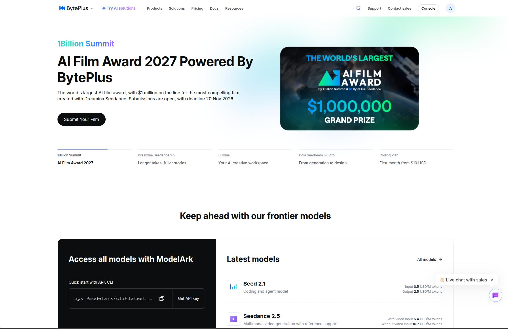
_BytePlus Site_

### **2. Accesing BytePlus Console**
> You can access the BytePlus Console [Here](https://console.byteplus.com/home)
{: .prompt-tip}

After accesing BytePlus, you can either click on the top right "**Console**" button, or access it through the subdomain.

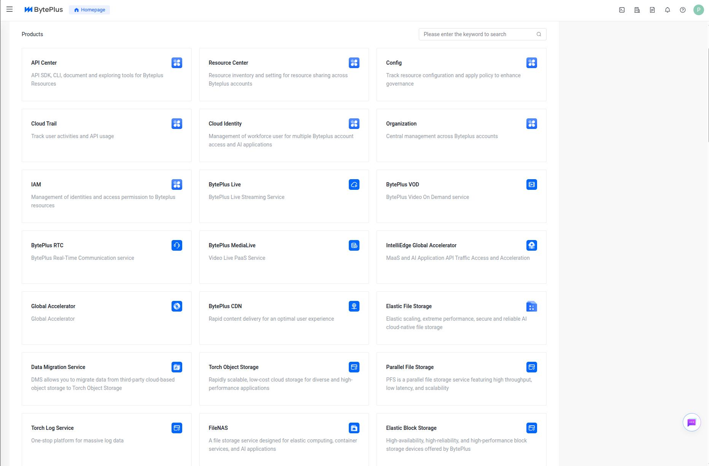
_BytePlus Console_

### **3. Find the Service**

On your first time accessing the console, you'll need to search or find the service from all of the provided services in the console. Use the search bar and search for "ECS or elastic" or type the full service name, if you've ever visited any services in the console, the service will be listed under a section called "**Recently Visited Services**"

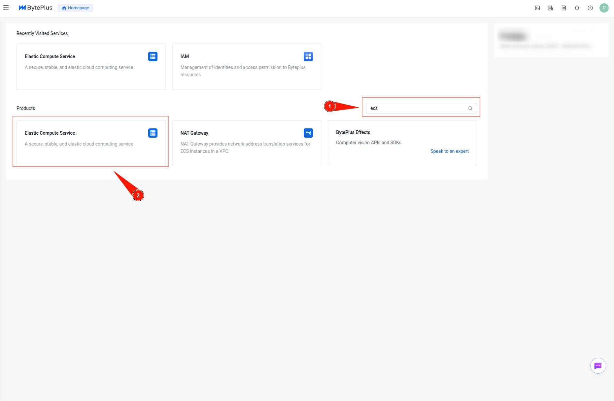
_BytePlus Console_

### **4. ECS Dashboard**

When the dashboard come up, you'll be shown the **overview dashboard**, you can either create your first instance from the button on overview dashboard, or you can create it from the instace sidebar.

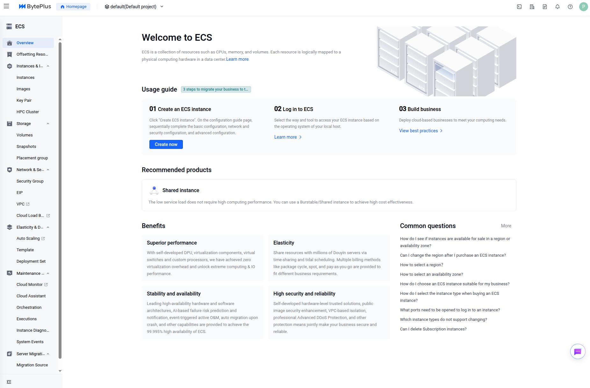
_BytePlus ECS Overview Dashboard_

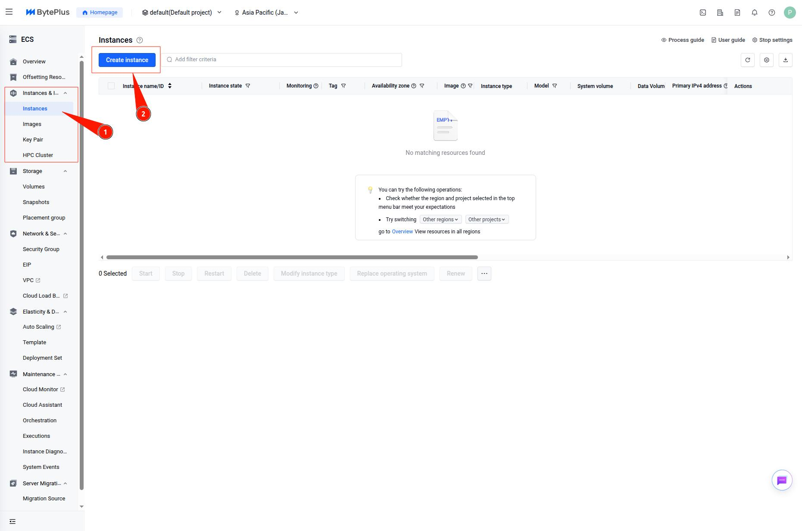
_BytePlus ECS Instance Sidebar_

---

## **Instance Configuration**
> Click on the tiny `?` button for more detailed information
{: .prompt-tip}

I will make the instance configuration as separate steps, since BytePlus has done a really nice job of explaining what certain configuration does, what they are, how they will impact the cost, etc.

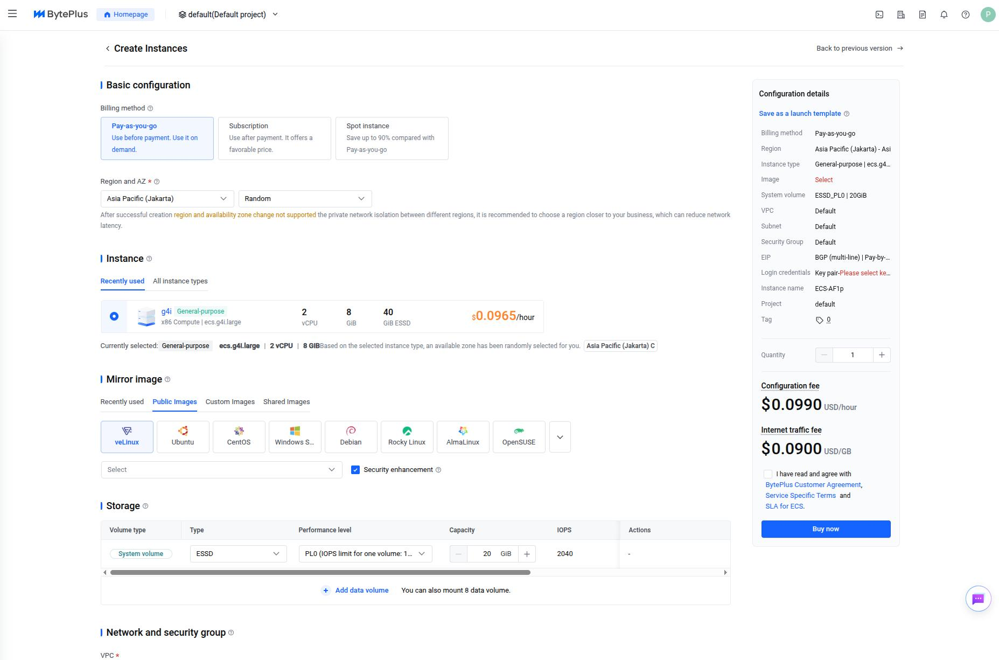
_instance creation overview_

### **1. Basic Configuration**

In the basic configuration section, there are two part that you can configure, which are **Billing Method** and **Region and AZ**.

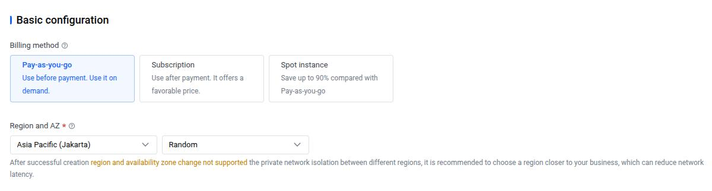
_Billing Method_

#### Billing Method
In the billing method part, there are 3 total options you can choose before creating your instance:
1.  **Pay-as-you-go**: Billed on the hour, and the instance is yours until you stop or delete it.
2.  **Subscription**: Billed settled by subsription term, like montly or annual.
3.  **Spot Instance**: Like pay as you go with bigger discount, but your instance can be released by BytePlus since you're using the spare capacity with warning of course

if you want a more detailed explanation, BytePlus already made the comparison table when you click the `?` button which explain it better than me.

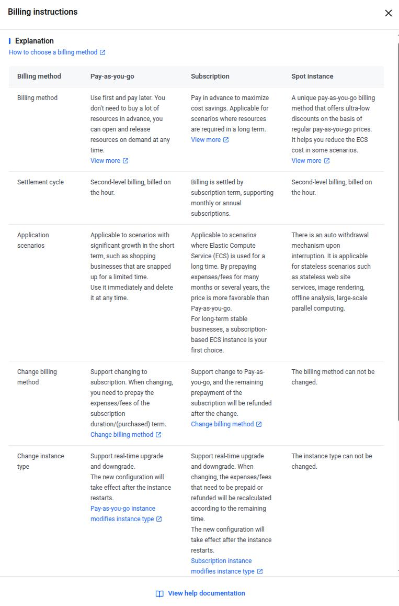
_Instance Billing Method Comparison | source: [BytePlus](https://docs.byteplus.com/en/docs/ecs/Billing-overview)_

#### Region and AZ
**Region** here is basically a geographical region where the data center is located. AZ which is short for **Availability Zone** refers to a physical data center. Again, if you want more detailed explanation on this check out the `?` button.

For basic configuration steps, i'll be choosing pay as you go **billing method**, and Asia Pasific (Jakarta) **region**,and Asia Pasific (Jakarta) A for the **AZ**

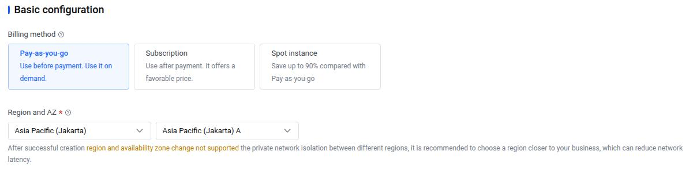
_Instance Basic Configuration_

### **2. Instance**

After configuring the billing and region, we can move on to choosing your instance type, this basically choosing the specifications for your instance that best fits your services or workload that you want to run on that instance.

There are several ways that you can filter through all the available instance types, from filtering them with the total amount of vCPUs, memory, and the usage of the instance, which come with this options:

1.  All
2.  General Purpose
3.  Compute Optimized
4.  Local-SSD
5.  Bare Metal
6.  Shared

Below are the recommended instance type families for your business scenarios based on BytePlus recommendation [Here](https://docs.byteplus.com/en/docs/ecs/Instance-type-selection-best-practice)

|Business Scenarion|Commonly Used Software|Recommended Instance Type Families|
|---|---|---|
|Web Service|Apache, Nginx|General Purpose, Compute Optimized, General Purpose EBM, Compute Optimized EBM|
|Middleware|RocketMQ, RabbitMQ, Kafka|General Purpose, General Purpose EBM|
|Database|MySQL,NoSQL|Memory Optimized, Local SSD|
|Cache|Redis, Memcache|Memory Optimized|
|Big Data|HDFS, MapReduce|Local SSD, Big Data|

For now i'll be choosing the **General Purpose** option, and choosing the **ecs.g4i** for the family, and **ecs.g4i.large** as the instance type.

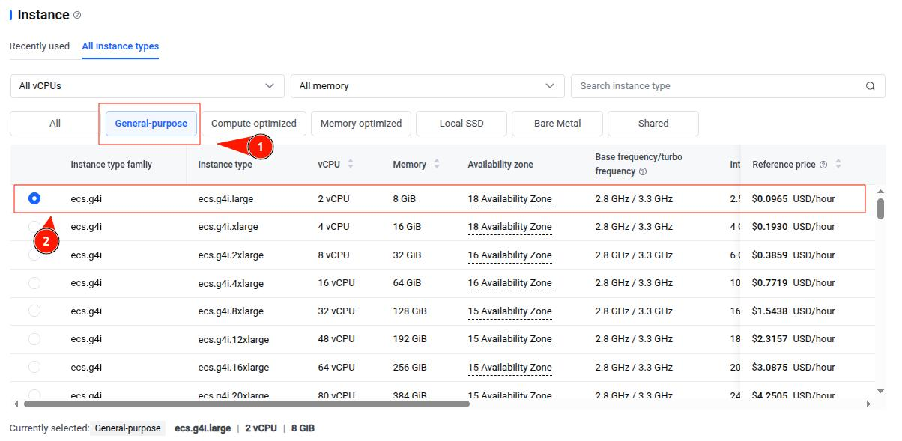
_Instance Type Picker_

### **3. Mirror Image**

Now we continue with choosing Operating Systems (OS), BytePlus called this **Mirror Image**, basically a place where you can pick and choose images for your instances. BytePlus gives 3 options for this:

1.  **Public Images**: Images that you pick from here, are provided by BytePlus.
2.  **Custom Images**: Images comes from our own uploaded or created private images.
3.  **Shared Images**: Images that are shared by other BytePlus account.

and after picking your image, there will be a dropdown section where you can choose your image version. For now, I'll be choosing **Debian** for the OS and for the version I'll be running the **Debian 12** version.

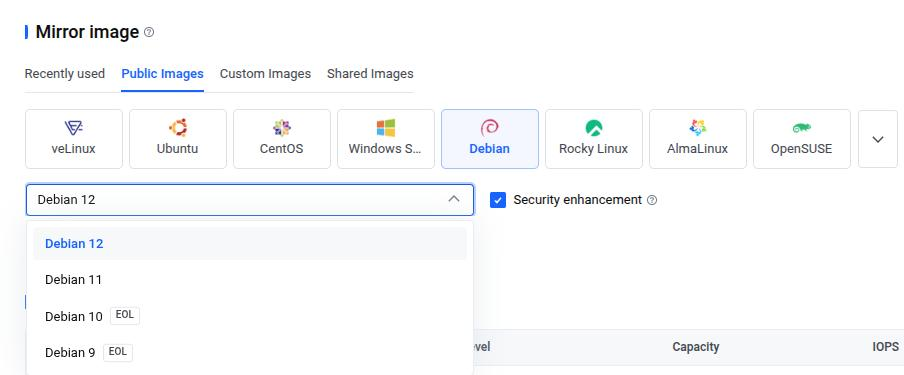
_Mirror Image_

### **4. Storage**
> Check the storage documentation [Here](https://docs.byteplus.com/en/docs/ecs/Overview-of-elastic-block-storage)
{: .prompt-tip}

ok so after choosing the image, now we pick the storage configuration, oh yea also known as **Elastic Block Storage (EBS)**, BytePlus gives several **Storage Types** and **Performance level** for the configurationc, and of course **system volume** and **data volume**. below are a quick introduction to it:

#### **Volume Type**

1.  **System Volume**: This type is used for storing your operating systems.
2.  **Data Volume**: This type is used to store the application data. (Note: you can mount a data volume pre or post ECS creation)

#### **Storage Type**

1.  **ESSD FlexPL**: ideal for intensive workload that require low latency
2.  **ESSD PL0**: ideal for moderate workload like small to medium size workload
3.  **TSSD TL0**: ideal for workload that need high bandwidth ant not sensitive to latency

> More detailed explanation on storage type, their use cases, and their benefit [Here](https://docs.byteplus.com/en/docs/ecs/Volume-specifications)
{: .prompt-tip}

for this guide, I'll be choosing for the system volume an **ESSD storage type** and the performance level **PL0**.

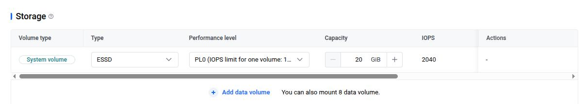
_Storage Configuration_

### **5. Network and Security Group**

Now we can move on to Network and security group configuration. there are a couple of things you can configure here:

1.  **VPC**: Virtual Private Cloud is an isolated virtual network environment for the resources on the cloud.
2.  **Subnet**: Subnet in cloud platform is a subdivison of an IP address range within a VPC
3.  **Security Group**: is an collection of security rules where you can use to filter traffic going in or out of the services.

Since this is a simple deploy your first ECS guide, we'll be using just default VPC, Subnet, and Security Group for this guide.

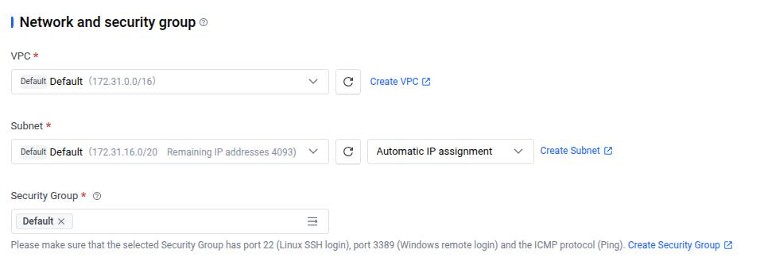
_Network and Security Group_

### **6. Public Network Access**

Next is the configuration so that your instance have internet connection, the configuration that you need to choose is enabling the "**Assign Elastic IP (EIP)**". and the rest is self explanatory.

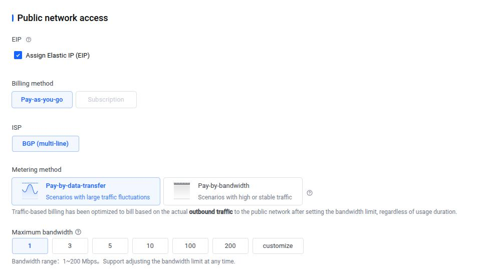
_Public Network Access_

### **7. Login Method**

For Login Method, there will be 2 options that we can use for the **Login Credentials**:

1.  **Password**: with password, you can connect/access the ECS from the console using the inputted password
2.  **Key Pair**: with Key pair, you'll be prompted to download the private key and store it somewhere, this will be used for connecting with SSH.

for this guide, we will use Key Pair, when choosing this options, we can either create it from this instance configuration, or create key pair before doing the instance configuration.

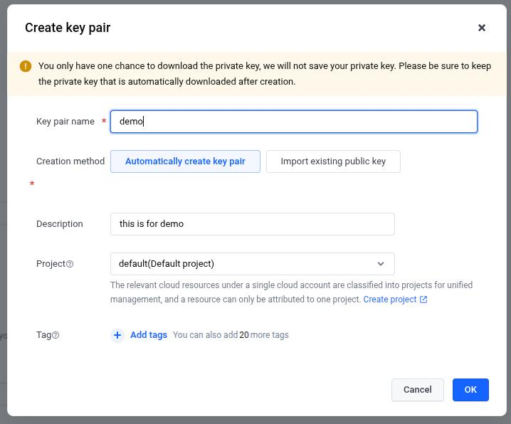
_Creating Key Pair_

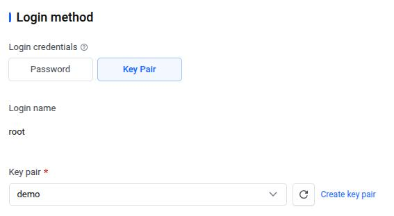
_Login Method_

### **8. Instance Configuration**

Lastly, it's **Instance Configuration**, in this section we can put in our instance name, hostname, and changing the project.

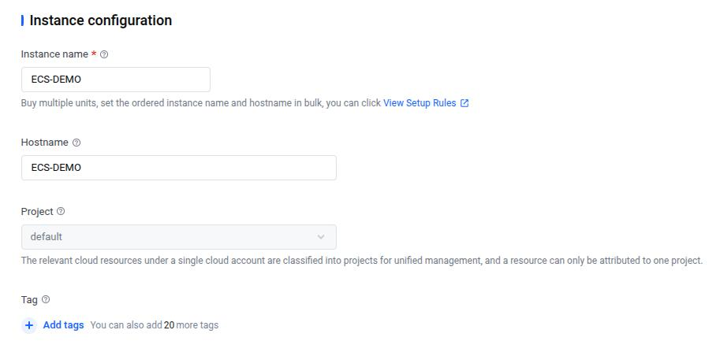
_Instance Configuration_

### **9. Deploying the Instance**

After the last instance configuration, on the right side of the dashboard there will be **Configuration Details** where you can see all the configuration that we've done and the price for it. To deploy just click **Buy Now**.

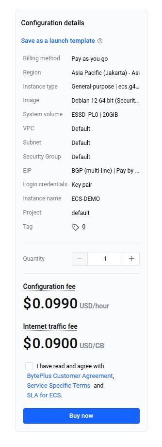
_Configuration Details Overview_

---

## **Post Instance Creation**

With the configuration process done, you'll be given a new page saying that the instance is submitted, and you can check it on the console.

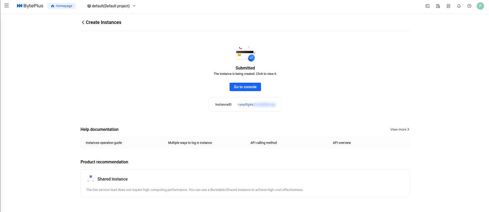
_Instance Submitted Page_

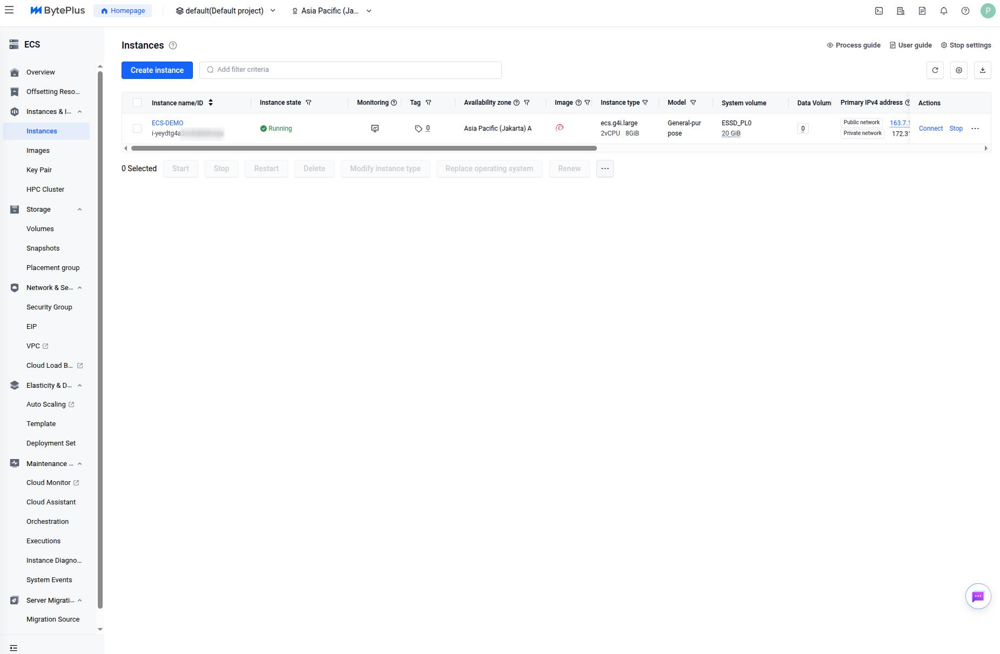
_Instance Deployed_

## **Connecting to Instance**

So now after the instance is up and running, we can try accesing the instance, we gonna use ssh for this

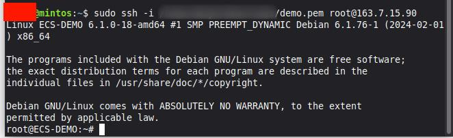
_Instance SSH Connect_

## **Finish**

Ok now you've deployed instance on BytePlus environment, congratulations!